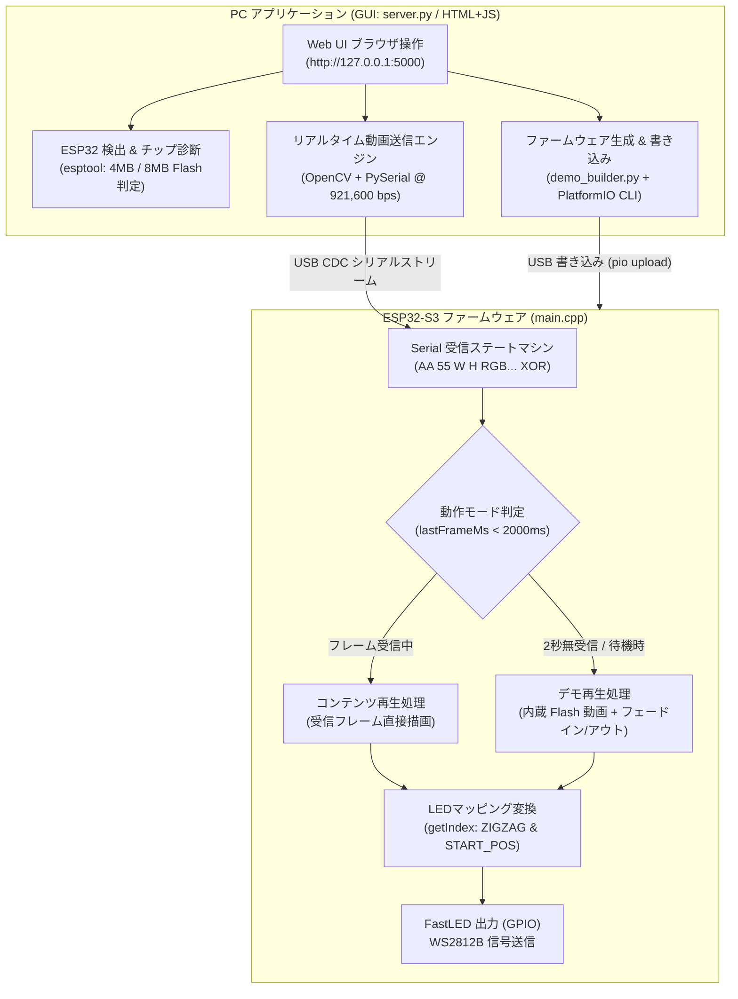
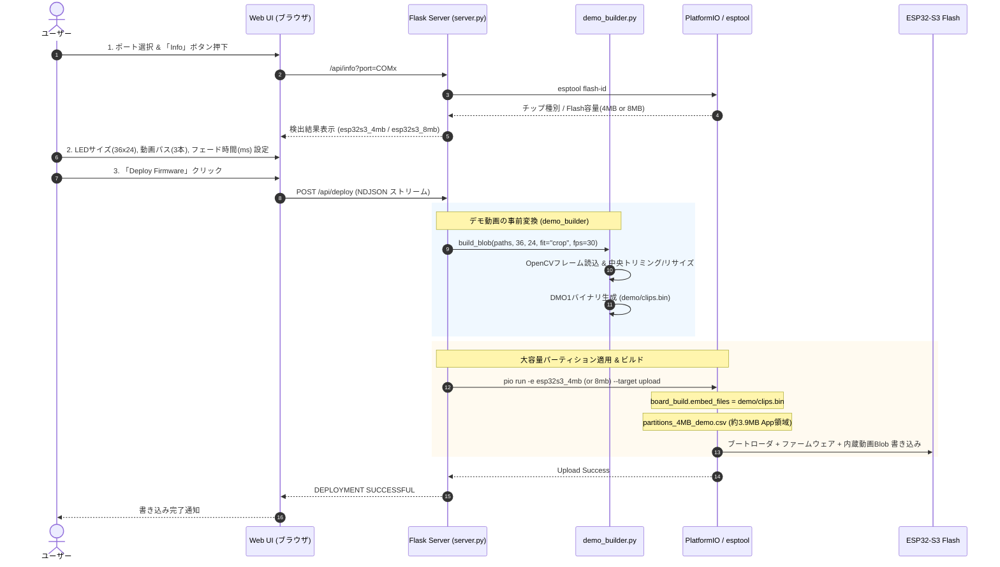
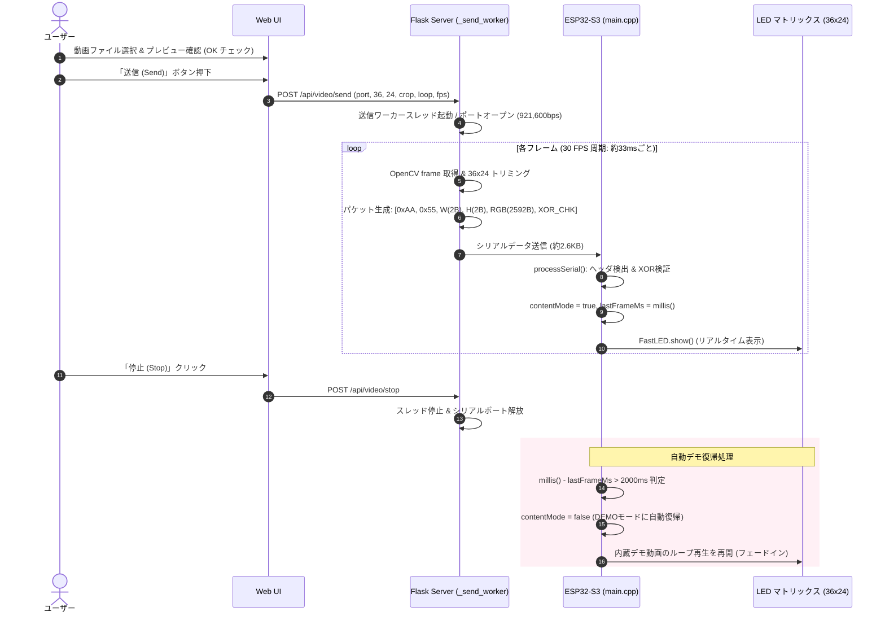
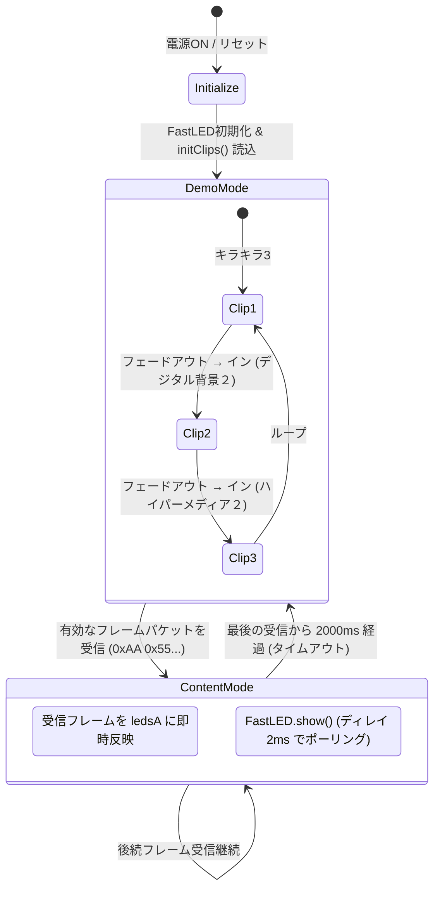

# ESP32 Hardware Tester Ver1.0 パイプライン概要

本ドキュメントは **Ver1.0** におけるシステム全体のデータフロー、処理パイプライン、およびステートマシン構成をまとめた設計図です。

---

## 1. システム全体アーキテクチャ

システムは大きく **PC側（Python / Flask GUI / OpenCV）** と **ESP32側（C++ / Arduino / FastLED）** の2つの層で構成されています。

---

## 2. パイプライン A: デモ動画内蔵 & FWビルド・デプロイ

PC上で選択した複数動画を LED 解像度にリサンプル・変換し、ファームウェアと一緒に大容量アプリ領域にフラッシュ書き込みする流れです。

---

## 3. パイプライン B: コンテンツ再生モード (PCライブストリーミング)

PC上で動画を再生しながらフレーム単位で RGB パケットをシリアル送信し、リアルタイムにマトリックスに投影する流れです。

---

## 4. ESP32 内部ステートマシン構成 (main.cpp)

ESP32 は起動直後から自律的に以下のステートマシンを実行します。

---

## 5. 主要データプロトコル仕様

### ① デモ動画 Blob フォーマット (`demo/clips.bin`)
Flashメモリ上に静的に配置されるバイナリ構造：

| オフセット | サイズ | 型 / 値 | 説明 |
|---|---|---|---|
| `0x00` | 4B | ASCII `"DMO1"` | マジック識別子 |
| `0x04` | 2B | uint16 (Little-Endian) | 幅 $W$ (例: 36) |
| `0x06` | 2B | uint16 (Little-Endian) | 高さ $H$ (例: 24) |
| `0x08` | 1B | uint8 | フレームレート (30 fps) |
| `0x09` | 1B | uint8 | 収録クリップ数 $N$ (例: 3) |
| `0x0A` | $2N$ B | uint16 × $N$ | 各クリップのフレーム数リスト |
| その後 | 可変 | RGBバイト列 ($W \times H \times 3$) | 行順 (Top-Left起点) のRAW RGBデータ |

### ② ライブストリーミング パケットフォーマット (Serial)
PCからESP32へUSBシリアル経由で送られる1フレーム分の構造：

| バイト位置 | サイズ | 値 / 内容 | 説明 |
|---|---|---|---|
| 0〜1 | 2B | `0xAA 0x55` | フレーム開始プリアンブル |
| 2〜3 | 2B | uint16 (Big-Endian) | 幅 $W$ (例: 36) |
| 4〜5 | 2B | uint16 (Big-Endian) | 高さ $H$ (例: 24) |
| 6〜 ($6+W \times H \times 3 - 1$) | $W \times H \times 3$ B | uint8 RGB配列 | 各画素のRGB値 (36×24の場合 2,592バイト) |
| 末尾 | 1B | XOR Checksum | ペイロード全バイトの累積 XOR 値 |
