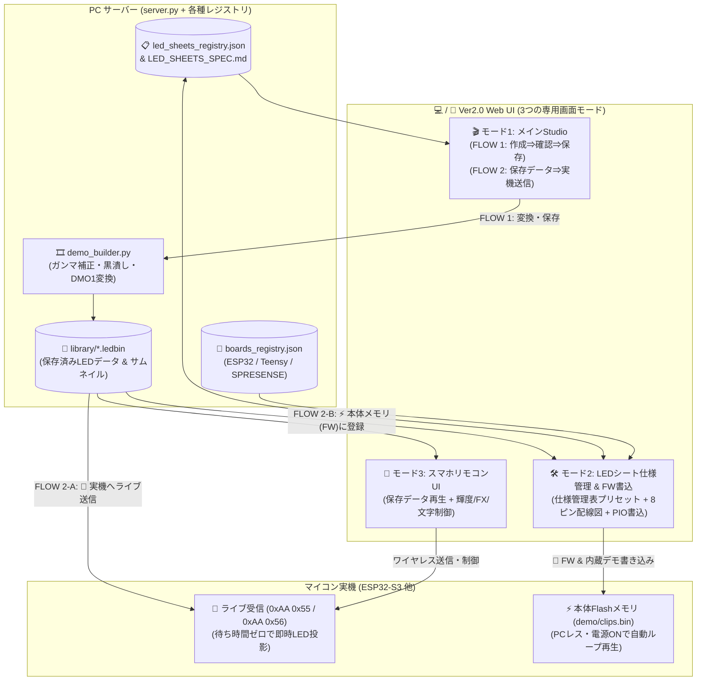

# ESP32 Hardware Tester & Manager Ver2.0 構想・仕様書・実装プラン

> **最終更新**: 2026-10-18 (Step 1 & Step 2: 新Web UI・2フローUX・LEDシート仕様管理表・メディア変換ライブラリ 実装完了)
> **関連ドキュメント**:
> - Ver1.0 パイプライン仕様: [VER1_PIPELINE.md](./VER1_PIPELINE.md)
> - 各種LEDシート仕様管理表: [LED_SHEETS_SPEC.md](./LED_SHEETS_SPEC.md) (`led_sheets_registry.json` と自動同期)
> - マルチMCUボード定義: [boards_registry.json](./boards_registry.json)

---

## 0. Ver2.0 コンセプト（6つの柱）

Ver1.0 で確立した「USBシリアルによるFW書き込み・内蔵デモ生成・ストリーム再生」の基盤を受け継ぎつつ、以下の 6 つの軸で大幅に進化させています。

1. **用途別に分離された 3モード Web UI（Studio / Hardware & Spec / Smartphone）**
   - 日常のコンテンツ制作・再生を行う **「🎬 1. 映像作成・確認・ライブ送信」** と、初期設定やFW書き込みを行う **「🛠️ 2. LEDシート仕様管理 & FW書込」**、スマホ用の **「📱 3. スマホリモコンUI」** を上部タブで明確に分離。
2. **知識がなくても直感的に使える 2ステップ・ワークフロー（FLOW 1 ➡ FLOW 2）**
   - **FLOW 1（データ作成 ⇒ シミュレータで確認 ⇒ 保存）**: 動画/GIF、電光掲示板（文字）、手描きドット絵、エフェクトからLEDデータを作成し、シミュレータで確認して保存。
   - **FLOW 2（保存済みデータ ⇒ 実機へ送信）**: 保存された一覧から「👀 シミュレータで見る」「📡 今すぐ実機へライブ送信（書き込み不要）」「⚡ マイコン本体メモリ(FW)に登録（電源ON自動再生用）」を迷わず選択可能。
   - シミュレータには **「現在表示中の映像バナー」** と **「👆 ワンクリック映像切替バー」** を常設。
3. **各種 LEDシート 仕様管理表 ＆ ワンクリック・プリセット機能**
   - 開発中の各種LEDシート仕様（解像度、総LED数、物理寸法/ピッチ、LEDチップ、電圧、色順、ピン構成、Zigzag、起点位置、推奨輝度）を `led_sheets_registry.json` および [LED_SHEETS_SPEC.md](./LED_SHEETS_SPEC.md) で一元管理。
   - プリセットから選ぶだけで全設定が一括適用され、マニュアル微調整や新規シート仕様の追加登録もWeb UIからワンクリックで可能。
4. **PC側：LED専用メディア変換スタジオ ＆ 共有ライブラリ（`library/*.ledbin`）**
   - WS2812Bの発色に不可欠な **LEDガンマ補正（$\gamma$）**、**コントラスト・彩度調整**、暗い背景ノイズを完全消灯させる **黒潰し閾値（Black Cutoff）** を備え、変換済みデータを `.ledbin` として保存。
5. **スマホ側：PC変換済みLEDソースの選択・再生 ＆ ワイヤレス制御（ハイブリッド構成）**
   - スマホ側はPCで変換・保存された `.ledbin` ライブラリをそのまま選んで再生・送信できるほか、輝度・カラー・エフェクト・文字スクロールをワイヤレス制御。
6. **マルチMCU拡張（Board Registry & HAL）＆ 最大 8 Data Pin 対応**
   - ESP32全シリーズ（S3/C3/C6/WROOM）に加え、**PJRC Teensy（4.0/4.1）** や **SONY SPRESENSE** への拡張余地を確保し、データピンも **最大 8 ピン（Ch.1〜Ch.8）** ＆ 3つのトポロジー（統合分割・独立ゾーン・ミラー）に対応。

---

## 1. システム全体アーキテクチャ & 画面構成フロー

---

## 2. ワークフロー設計（初心者でも迷わない2ステップUX）

### 2.1 📺 LEDシミュレータ（実機イメージ確認モニター）
- **現在再生中バナー（Now Playing Banner）**:
  - 現在シミュレータに表示されている映像の種別（`📂 保存済みデータ再生中` / `🎬 動画変換プレビュー中` / `🔤 電光掲示板プレビュー中` / `🎨 手描きドット絵` / `✨ エフェクト`）と **タイトル名** を常時明示。
- **👆 ワンクリック映像切替バー**:
  - シミュレータ直下に保存済みデータと主要エフェクトのピルボタンを並べ、1クリックで表示映像を切り替え可能。
- **リアルタイム消費電流・電力推定**:
  - 選択中のLEDシート仕様（5V / 12V、最大電流）と現在のフレーム全ピクセルの発光量・輝度スライダー値から、リアルタイムに推定電流（`A`）と消費電力（`W`）を算出。

### 2.2 FLOW 1：新しく作る・変換する（データ作成 ➡ シミュレータで確認 ➡ 保存）
| 作成タブ | 機能概要 | 出力 |
|---|---|---|
| **🎬 ① 動画・GIFから変換** | MP4/MOV/GIF等を読込、縦横比（トリミング/引き伸ばし/黒帯）、LEDガンマ補正（$\gamma=1.0\sim2.8$）、コントラスト、彩度、黒潰し閾値（暗部ノイズカット）を調整 | `library/*.ledbin` |
| **🔤 ② 電光掲示板（文字）** | 日本語・英数字・絵文字テキスト、文字色、背景色、スクロール速度を指定してスクロールアニメーションを生成 | `library/*.ledbin` |
| **🎨 ③ 手描きドット絵** | シミュレータ画面上をマウスや指で直接なぞってドット絵を描画・全面塗り・クリア | `library/*.ledbin` |
| **✨ ④ 内蔵エフェクト** | Center Rainbow / Cyber Plasma / Fire Matrix / Digital Matrix Rain / Starlight Sparkle のプロシージャル生成 | `library/*.ledbin` |

### 2.3 FLOW 2：保存データを選んで使う（2通りの実機反映方法）
保存された各データカードには、目的別に以下のボタンを配置しています。
1. **`👀 シミュレータで見る`**: 実機が無くてもPC画面上でドットイメージと消費電流を確認。
2. **`📡 実機へライブ送信`**: USBシリアル（またはWi-Fi）で接続中のLEDシートへ、FW書き換えなしで即座にリアルタイム投影。
3. **`⚡ 本体メモリ(FW)に登録`**: マイコンのFlashメモリ書き込みリストへ追加。登録後に「🛠️ 2. LEDシート仕様管理 & FW書込」タブでDeployを実行すると、PCを外しても電源ONだけで自動ループ再生される。

---

## 3. 各種 LEDシート 仕様管理表 ＆ 最大 8 Data Pin 対応

### 3.1 仕様管理表（`led_sheets_registry.json` & `LED_SHEETS_SPEC.md`）
マニュアル設定の手間と設定ミスを無くすため、開発中の各種LEDシート仕様をプリセット登録し、Web UIの仕様管理表とMarkdownファイル（[LED_SHEETS_SPEC.md](./LED_SHEETS_SPEC.md)）の双方で自動同期・管理します。

- **管理項目**: 型番コード、シート名称、解像度（$W \times H$）、総LED数、物理寸法/ピッチ、LEDチップ種別（WS2812B/E, WS2813, WS2815 12V, SK6812）、電源電圧、色順序（GRB/RGB等）、データピン構成（最大8ピン）・トポロジー（統合分割 / 独立ゾーン / ミラー）、起点位置（TL/TR/BL/BR）、Zigzag有無、安全推奨輝度、用途メモ。
- **配線・チャンネル割り当てプレビュー（`#hw-wiring-canvas`）**:
  - `Ch.1`〜`Ch.8` の各GPIOピンが担当するエリア、LED `★No.1` の起点位置、蛇行配線（Zigzag）の折り返し方向をキャンバス上に自動作図。

---

## 4. マルチMCU拡張（Board Registry & HAL）

`boards_registry.json` により以下のマイコンシリーズを定義し、順次HAL（Hardware Abstraction Layer）を展開できる設計としています。
- **Espressif ESP32 Series**: `ESP32-S3` (4MB/8MB/16MB), `ESP32` (WROOM), `ESP32-C3`, `ESP32-C6`
- **PJRC Teensy Series**: `Teensy 4.0`, `Teensy 4.1`（USB 2.0 Hi-Speed 480Mbps / OctoWS2811 8ピン並列DMA向け）
- **SONY SPRESENSE Series**: `SPRESENSE Main Board (CXD5602)`（マルチコア・1.5MB SRAM・ハイレゾ音響解析×LED制御向け）

---

## 5. 通信プロトコル仕様（Ver2.0 拡張）

| ヘッダ | パケット種別 | 構造 | 備考 |
|---|---|---|---|
| `0xAA 0x55` | **統合フレーム送信** | `AA 55 \| W(2B,BE) \| H(2B,BE) \| RGB(W×H×3) \| XOR(1B)` | **Ver1.0 完全互換**。統合キャンバス全体を更新 |
| `0xAA 0x56` | **ライブ制御コマンド** | `AA 56 \| CMD(1B) \| LEN(2B,BE) \| PAYLOAD(LEN) \| XOR(1B)` | FW再書込なしで輝度(`0x01`)・モード(`0x02`)・クリップ(`0x03`)・テスト(`0x04`)・FX(`0x05`)を即時制御 |
| `0xAA 0x57` | **チャンネル別フレーム送信** | `AA 57 \| CH_ID(1B:0-7) \| W(2B) \| H(2B) \| RGB... \| XOR(1B)` | 特定チャンネル（0〜7）のみをピンポイント更新 |

---

## 6. 開発マイルストーン・進捗状況

### ✅ Step 1: バックエンド基盤（完了）
- [x] `boards_registry.json` の作成（ESP32各機種、Teensy 4.x、SONY SPRESENSE、LEDチップ定義）
- [x] `led_sheets_registry.json` ＆ `LED_SHEETS_SPEC.md` 自動同期エンジンの実装
- [x] `demo_builder.py` の強化（ガンマ補正、コントラスト・彩度、黒潰し閾値、ズーム、`library/*.ledbin` 保存・読込機能）
- [x] `server.py` の Ver2.0 API 拡張（仕様管理表API、ライブラリ管理API、変換プレビューAPI、最大8ピンビルドフラグ生成、ライブ制御API、スマホLAN接続URL/QR情報API）

### ✅ Step 2: 新 Web UI（PC Studio / LEDシート仕様管理表 / スマホリモコン UI）（完了）
- [x] 3モード分離ナビゲーション（`🎬 1. 映像作成・確認・ライブ送信` / `🛠️ 2. LEDシート仕様管理 & FW書込` / `📱 3. スマホリモコンUI`）
- [x] 仮想LEDマトリックス・シミュレータ（現在再生中バナー、ワンクリック映像切替バー、8ch境界オーバーレイ、リアルタイム推定電流 `A`・電力 `W` 計算）
- [x] 初心者向け 2ステップUX（`FLOW 1: 作成⇒確認⇒保存` ＆ `FLOW 2: 保存データ⇒ライブ送信 / FW登録`）
- [x] 開発中LEDシート仕様管理表（プリセット一括適用、新規シート仕様登録モーダル、8ピン配線プレビュー図）

### 🔜 Step 3: ファームウェア Ver2.0（次回以降フェーズ）
- [ ] `src/main.cpp` のマルチピン（最大8ピン）FastLED 展開 ＆ 3トポロジー対応の実装
- [ ] ファームウェア側での `0xAA 0x56` ライブ制御コマンド（再書込なしの輝度リアルタイム変更・内蔵クリップ指定再生）受信処理の実装
- [ ] ESP32 Wi-Fi（SoftAP / STA）＋ WebSocket サーバー実装（PCレスでのスマホ直結ワイヤレス制御）
- [ ] Teensy / SONY SPRESENSE 用 HAL テンプレートの整備 ＆ 実機検証
